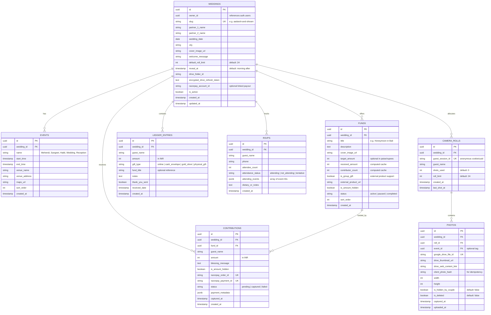
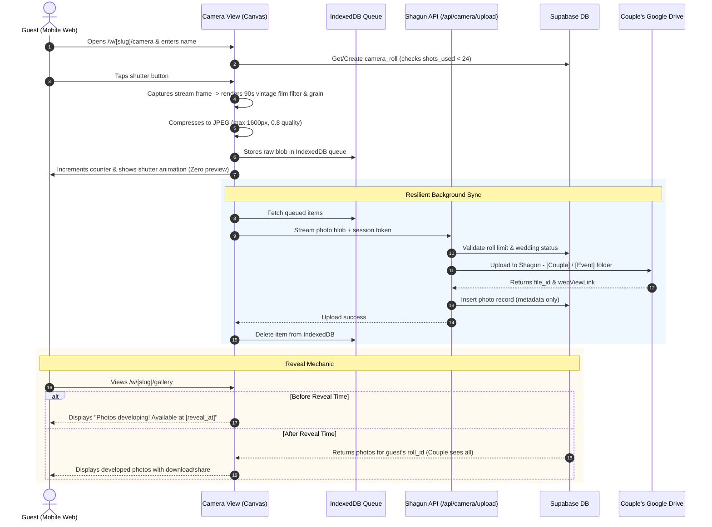

# Shagun Architecture Document
**Version:** 1.0.0 (MVP)  
**Target:** Indian Wedding Gifting & Memories Platform  

---

## 1. Executive Summary & System Overview

**Shagun** is a mobile-first, privacy-respecting wedding gifting and collective memory platform tailored for the modern Indian wedding ecosystem. It solves three critical problems:
1. **Dignified Shagun (Gifting):** Replacing awkward cash envelopes with seamless UPI contributions toward meaningful couple-defined milestones ("Honeymoon in Bali", "Our First Home", or group physical gifts) without holding escrow or taking cuts.
2. **Comprehensive Shagun Ledger:** Digitizing and aggregating all online gifts and offline physical cash/shagun envelopes in one place, with one-click thank-you tracking and CSV exports.
3. **Venue Disposable Camera:** An in-browser nostalgic disposable camera with a 24-shot roll per guest, vintage film aesthetics, zero app install, offline queueing, and an "undeveloped until the morning after" reveal mechanic. Photos are transferred directly to the couple's private Google Drive (scoped strictly to `drive.file`).

---

## 2. System Architecture Diagram

```mermaid
flowchart TD
    subgraph Clients["Clients (Mobile-First Web & PWA)"]
        GuestMobile["Guest Device (Android/iOS Browser)\n- Low-end 4G optimized\n- No login required\n- Direct Couple UPI & QR\n- In-browser Disposable Camera\n- next-intl (EN / HI / MR)"]
        CoupleMobile["Couple Dashboard\n- 30-Day Pass & Activation Code\n- Couple UPI & 2 Phone Numbers\n- Wedding & Funds CRUD\n- Shagun Ledger + Offline Gifts\n- QR Posters & Photo Gallery"]
        PlatformOwner["Platform Owner / Admin\n- Platform Scanner QR Code\n- 30-Day Activation Passes (1 couple only)"]
    end

    subgraph EdgeVercel["Next.js 14 App Router (Vercel)"]
        RouteHandlers["API Routes & Webhooks\n- /api/camera/upload\n- /api/export/ledger-csv\n- /api/razorpay/webhook"]
        AppPages["SSR & Client Pages\n- / (Landing & Platform Scanner QR)\n- /activate (30-Day Pass Purchase)\n- /dashboard/* (Couple Suite)\n- /w/[slug] (Guest Portal & Direct UPI)\n- /w/[slug]/camera (Venue Camera)"]
        RateLimiter["In-Memory Token Bucket\nRate Limiting & Anti-Abuse"]
    end

    subgraph DataStorage["Data & Storage Layer"]
        SupabasePostgres[("Supabase PostgreSQL\n- Weddings & Activation Passes\n- Funds & Direct UPI Contributions\n- Offline & Online Ledger\n- Photo Metadata & Rolls\n- Row Level Security (RLS)")]
        GoogleDrive["Google Drive API\n(drive.file scope only)\nFolder: Shagun - Couple / Event /\nOriginal Image Storage"]
    end

    subgraph DirectUPIFlow["Direct Bank Settlement (Zero Platform Middleman)"]
        GuestUPIApp["Guest UPI App (PhonePe / GPay / Paytm / BHIM)"]
        CoupleBank["Couple's Personal Bank Account (Linked to 2 Registered Mobile Numbers)"]
    end

    GuestMobile -->|Direct UPI Payment| GuestUPIApp
    GuestUPIApp -->|100% Direct Settlement (Zero Redirection to Platform)| CoupleBank
    GuestMobile -->|Record Blessing & UTR| AppPages

    CoupleMobile -->|Scan Platform QR & Claim 30-Day Pass| PlatformOwner
    PlatformOwner -->|Single-Couple Code (30 Days Active)| CoupleMobile

    GuestMobile -->|Browse & RSVP| AppPages
    GuestMobile -->|Initiate UPI| RouteHandlers
    RouteHandlers -->|Create Order| RazorpayGateway
    RazorpayGateway -->|Direct UPI Settlement| CoupleMobile
    RazorpayGateway -->|Signed Webhook Event| RouteHandlers
    RouteHandlers -->|Idempotent Write| SupabasePostgres

    GuestMobile -->|Capture & Queue Filtered Photos| RouteHandlers
    RouteHandlers -->|Token-authorized upload| GoogleDrive
    RouteHandlers -->|Save photo metadata| SupabasePostgres

    CoupleMobile -->|Google Sign-in| GoogleOAuth
    CoupleMobile -->|Manage Wedding & View Ledger| AppPages
    AppPages -->|Direct authenticated queries via RLS| SupabasePostgres
```

---

## 3. Technology Stack & Key Decisions

| Layer | Technology | Rationale & Trade-offs |
|---|---|---|
| **Framework** | Next.js 14 (App Router) + TypeScript | Hybrid SSR/Static for fast initial paint on 4G networks; API route handlers for secure webhooks; TypeScript strict typing. |
| **Styling & Design System** | Tailwind CSS + Lucide Icons | Warm Indian wedding aesthetics (marigold, deep maroon, ivory, gold); lightweight CSS bundle (<30KB) with zero runtime penalty. |
| **Database & Auth** | Supabase (PostgreSQL + Auth + RLS) | Strict multi-tenant data isolation using Postgres Row Level Security; instantaneous setup; native Google Auth integration. |
| **Payments** | Razorpay (Test / Standard UPI) | Dominant Indian payment gateway supporting UPI QR, Google Pay, PhonePe, Paytm intent; signed webhooks ensure client trustlessness. |
| **Media Storage** | Google Drive API (`drive.file` scope) | Zero server hosting cost for couple photos; couples own their original media forever; scoped strictly to files created by the app. |
| **Camera & Processing** | Web Audio / Canvas 2D / IndexedDB | Client-side vintage film grain and color grade; max 1600px JPEG compression (0.8 quality); offline queue via Dexie/IndexedDB for weak 4G venue connectivity. |
| **Internationalization** | `next-intl` | Seamless locale routing (`/en`, `/hi`, `/mr`); negligible footprint; server component compatibility. |
| **PWA & Offline** | Serwist / `@ducanh2912/next-pwa` | Enables "Add to Home Screen" for couple and offline shell caching for guests in low-reception wedding banquets. |

---

## 4. Database Schema & Data Model



---

## 5. Security & Privacy Architecture

### 5.1 Google Drive Integration (`drive.file` Scope)
- **Zero Full Drive Access:** Only `https://www.googleapis.com/auth/drive.file` is requested during couple OAuth. The application can only view, edit, and delete files that the app itself created.
- **Token Protection:** The OAuth `refresh_token` is encrypted using AES-256-GCM before writing to the database with a server-side encryption key (`ENCRYPTION_SECRET_KEY`).
- **Media Privacy:** Photo binary bytes are never stored in the database. The client uploads chunks through an authenticated Next.js API stream directly to the couple's Drive folder:
  `Google Drive -> Shagun – [Couple Names] / [Event Name] / photo-[hash].jpg`.
- **Revocation Safety:** The couple can revoke access at any time from their Google Account or in-app dashboard. The app gracefully disables uploads and notifies guests.

### 5.2 Row Level Security (RLS) Matrix

| Table | Public Guest (Anonymous) | Couple (Authenticated Owner) | Service Role (Webhooks & Background) |
|---|---|---|---|
| `weddings` | Read-only where `is_active = true` (excluding tokens) | Full CRUD for `owner_id = auth.uid()` | Full access |
| `events` | Read-only by `wedding_id` | Full CRUD for owned wedding | Full access |
| `funds` | Read-only by `wedding_id` | Full CRUD for owned wedding | Full access |
| `contributions` | Insert pending; Read captured where `wedding_id` (masks amount if `is_amount_hidden`) | Full Read for owned wedding | Full CRUD (webhook verification updates status) |
| `ledger_entries`| No access | Full CRUD for owned wedding | Full access |
| `rsvps` | Insert with rate limiting | Full Read & Delete for owned wedding | Full access |
| `camera_rolls` | Insert/Update own `guest_session_id` | Full Read for owned wedding | Full access |
| `photos` | Read own `roll_id` ONLY after `reveal_at` and `!is_hidden` | Full Read, Update (`is_hidden`), Delete | Full access |

### 5.3 Payment Integrity & Webhook Idempotency
- **No Escrow / No Custody:** Payments route directly through Razorpay to the couple's verified settlement bank account.
- **Client Status Untrusted:** The front-end payment callback displays a pending/processing indicator. The contribution is only confirmed in the database when the Razorpay webhook fires with a valid `X-Razorpay-Signature` verified with `crypto.createHmac("sha256", RAZORPAY_WEBHOOK_SECRET)`.
- **Idempotency Guarantee:** Every webhook event is checked against processed `razorpay_payment_id` to prevent double-counting.

---

## 6. Disposable Camera & Media Pipeline



---

## 7. Internationalization (i18n) Architecture

- Implemented via `next-intl` with route matching:
  - English: `/en/...` (or default prefix)
  - Hindi: `/hi/...` (संपूर्ण हिंदी समर्थन: "आशीर्वाद और शुभकामनाएं", "शगुन भेंट", "कैमरा")
  - Marathi: `/mr/...` (मराठी स्वरूप: "आशीर्वाद आणि शुभेच्छा")
- Translation keys organized by feature namespace: `common`, `landing`, `couple_dashboard`, `guest_portal`, `funds`, `camera`, `ledger`, `rsvp`.
- Persistent language switcher pill floating or anchored in the navigation.

---

## 8. Performance & Low-End Device Optimization

1. **Lightweight Guest Bundle:** Initial JavaScript bundle for guest portals is strictly under 180KB gzipped.
2. **Dynamic Code Splitting:** The camera engine (HTML5 Canvas filter, stream capture, Dexie IndexedDB sync) is dynamically loaded with `next/dynamic` only when the guest opens `/w/[slug]/camera`.
3. **High-Contrast Typography & Touch Targets:**
   - Minimum tap target size: 48px × 48px.
   - Text contrast meets WCAG AA (>= 4.5:1 for standard text, 3:1 for large text).
   - High readability fonts: Rozha One / Playfair Display for headings; Inter / Plus Jakarta Sans for body.
4. **Resilient Network Handling:** In banquet halls with 500+ guests competing for 4G towers, camera uploads degrade to background queueing without blocking the shutter button.

